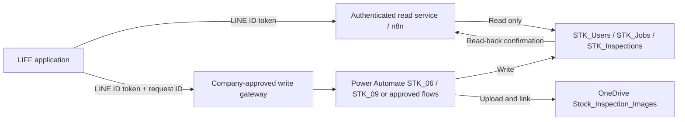

# Integration contract and blockers

**Status: NOT TESTED against company services. Keep live writes disabled.** All executable tests in this PR use local fixtures. The original frontend named n8n STK_04, STK_07, STK_08, STK_10 and Power Automate STK_06/STK_09, but their definitions are absent. Exact action-to-flow ownership must be confirmed with the integration owner.

## Required architecture



n8n must not create, modify, delete, or upload in Microsoft 365. A company-approved gateway can delegate to Power Automate, but no signed Flow trigger URL or privileged token belongs in browser config. No permission changes, anonymous links, or extra credentials are proposed.

## Browser transport

HTTPS POST, JSON serialized in a `text/plain` body (legacy transport retained). CORS and `Origin` are not authorization. Gateway validates LINE ID token signature, issuer, audience, expiry and current STK_Users approval/role on every request. Never trust user identity, role or item ownership from the payload.

Reads:

```json
{ "action": "status", "idToken": "<memory-only LINE ID token>" }
```

Approved response: `{ "registered": true, "accessStatus": "approved", "fullName": "…", "nickname": "…", "role": "Inspector" }`. Other supported states are `pending`, blocked/non-approved status, and `{ "status": "NOT_REGISTERED", "registered": false }`. Unauthorized/expired token: HTTP 401; unapproved/forbidden: HTTP 403. Full registration data must not be returned to unauthorized users.

```json
{ "action": "jobs", "idToken": "<memory-only LINE ID token>" }
```

Response: `{ "status": "OK", "jobs": [], "source": "STK_Jobs+STK_Inspections", "partial": false }`. A successful read must include all pages of authorized jobs and inspection rows. Set `partial: true` when pagination/permissions cause incompleteness; client blocks writes and labels incomplete totals. Empty success is valid, failure must not become an invented empty success.

Job fields: `id` (stable business job key), `sharePointItemId` (positive Lists ID), `title`, `product`, `model`, `claimCategory`, `status`, `targetUnits`, `checkingMethod`, `inspectionLocation`, `result1Criteria`–`result4Criteria`, `okPictureUrl`, `ngPictureUrl`, `reportUrl`, `notes`, `startedAt`, `updated`, `records`.

Inspection fields: `id`, `sharePointItemId`, `serial`, `model`, `checkedAt`/`inspectionDate`, `result1`–`result4`, `overallResult`, `lotNo`, `note`/`remarks`, `ngDetail`, `photoUrl1`, `inspector`, `deleted`. Client maps common PascalCase fields and hyperlink `{Url,Description}` objects. Gateway must explicitly join by job relationship; browser cannot prove joins from the JSON alone.

New fields for robust reconciliation: `clientRequestId` on job/inspection read models, derived from the write journal. Use stable IDs; never use display title as proof of item ownership. Existing normalized camelCase contract is preferred over raw Lists objects.

## Writes: Power Automate / approved channel only

Configure `registrationWriteUrl` separately; action `register`, body fields `fullName`, `nickname`. Uniqueness by verified LINE user ID must be enforced on the server. Supported acknowledgement statuses: `REGISTRATION_SUBMITTED` or `REGISTRATION_REQUEST_ACCEPTED`. An acknowledgement is a request, not approval.

Other write envelope:

```json
{
  "action": "saveInspection",
  "idToken": "<memory-only LINE ID token>",
  "clientRequestId": "<UUID persisted before transmission>",
  "payload": {
    "jobKey": "EXAMPLE-JOB",
    "itemId": 123,
    "recordItemId": 0,
    "serial": "EXAMPLE-001",
    "model": "L5018",
    "inspectionDate": "2026-11-16",
    "result1": "NG", "result2": "NA", "result3": "NA", "result4": "NA",
    "lotNo": "", "remarks": "", "ngDetail": "Criterion label", "photoUrl1": ""
  }
}
```

Actions retained: `createJob`, `updateJob`, `selectJob`, `saveInspection`, `finishJob`. Delete stays disabled. Return `{ "status": "WRITE_REQUEST_ACCEPTED", "requestId": "…" }` only after a durable queue/job exists. Browser then reads the resulting entity and compares the expected fields before showing saved status. An ambiguous timeout remains locked and offers **check result**, not resend.

- `createJob`: preserve existing `problem`, `model`, `claimType` (legacy Product), `detail`, job-fields payload; return a request ID that is available as the suffix of `id` or `importKey`, matching the original contract. Also echo `clientRequestId` in the persisted read model to reconcile a lost acknowledgement.
- `updateJob`: existing criteria/method/location/notes/reference URLs plus **new `title` and `targetUnits`**. Verify these fields before enabling writes; if absent on read-back, client will not claim the update succeeded.
- `saveInspection`: `recordItemId:0` means create. Positive record item ID means update the existing row, never append. Enforce serial uniqueness on normalized `(jobKey, serial.toUpperCase())` unless the business specifies another scope. Only `OK`, `NG`, `NA` are valid per-criterion states.
- `selectJob`: verify current status NEW and required criteria before moving to progress.
- `finishJob`: reject missing/empty criteria or any incomplete record, including partial NG, inside the same server-side transaction. Display target is not evidence that all units were inspected; confirm target-vs-finish business policy.
- Every write validates jobKey ↔ Lists itemId ↔ recordItemId relationship and the caller's job access. The UI does not grant permissions.
- Deduplicate `clientRequestId` atomically, return the original result for replay, keep request status long enough for mobile recovery. Client-side checks cannot guarantee cross-device uniqueness.
- Require row/version preconditions (ETag or equivalent) on server to prevent the race between a client preflight read and write. Frontend preflight is an early conflict warning, not atomic concurrency control. **Version contract is still an integration blocker.**

If the acknowledgement is lost, the client only reconciles using a matching persisted `clientRequestId`. If the existing backend does not expose it, the request remains unknown and needs an operator to verify the Flow run / Lists row. Never clear an unknown request and resend merely because time elapsed.

## Photo contract

Job references: `OKPictureURL`, `NGPictureURL`; vehicle evidence: `PhotoURL1`. No new anonymous sharing. Protected links may fail as inline images while opening successfully in a Microsoft-authenticated tab; UI says this explicitly.

Upload through `photoGatewayUrl` to the approved writer, never directly through Microsoft Graph from n8n. Legacy body: `photoType` (`JOB_OK`, `JOB_NG`, `SERIAL`), positive `itemId`, `jobKey`, `serialNumber`, `mimeType:'image/jpeg'`, compressed `fileBase64`, UUID `requestId`, LINE `idToken`. File input limit 15 MB; client compresses locally to JPEG with longest edge at most 1400px and bounded payload. Validate file bytes, type, size, identity and destination again on server.

Legacy acknowledgement `{ "success": true, "status": "PHOTO_UPLOADED_TO_INCOMING" }` means **accepted by the upload service only**. STK_09/approved flow must persist file and update the correct Lists URL. Only a subsequent authorized read with that linked URL is confirmed evidence. Mock deliberately refuses uploads; selecting a file never generates a fake success URL. Failed replacement retains the previously confirmed URL.

## Business decisions and integration blockers

| Blocker | Required evidence before live enablement |
|---|---|
| Flow ownership and read-only n8n | STK_04/07/08/10 exports reviewed; all Microsoft mutations performed by approved PA flows |
| Auth/roles/session | Real LINE launch/login/relogin, pending/blocked/approved users, expired token, forbidden role with no data leak |
| Writes and field mapping | Company sandbox STK_06 create/update/start/save/finish read-back; title/target/notes/criteria coverage |
| Uniqueness and concurrency | Business-approved serial scope, atomic uniqueness, idempotency replay, ETag/version rejection |
| Read completeness | Microsoft Lists pagination, authorized joins, `partial` semantics and missing field behavior |
| Photos | STK_09 and approved upload path; protected URLs, lost acknowledgement, upload accepted but URL not linked, replacement failure |
| Actual QR labels | Approved manufacturer QR examples; currently plain Serial, JSON with exactly one serial key, or key=value segments separated by `;`, `|`, newline |
| Devices | Real Android/iPhone cameras, LINE WebView, permission denial, background/resume, keyboard, safe area |
| PDF | Print/Save PDF on target mobile browser, or existing backend PDF link; LINE WebViews may require opening an external browser |
| Acceptance | Compare sandbox counts and report rows to Lists; obtain business sign-off before production |

No item in this table was tested against production by this change. Frontend readiness does not establish production integration readiness.
